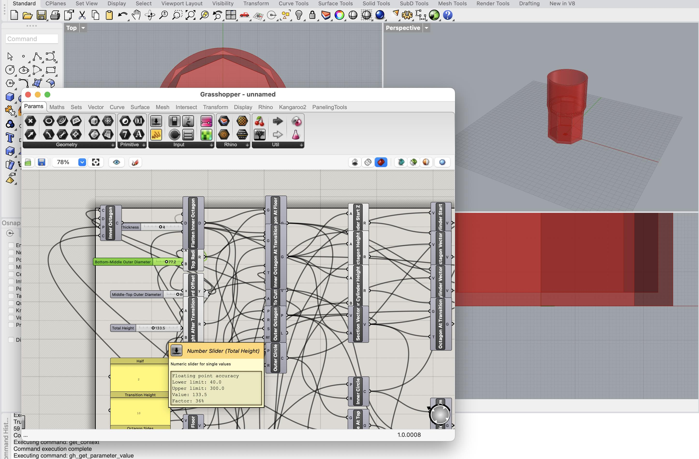

# SignAid · 美国手语辅助取物

SignAid 面向使用美国手语（ASL）的用户，旨在基于 WLASL 数据集构建限定词汇范围内的手语识别功能，将识别结果映射为取物请求，由 SO-101 机械臂抓取对应物品并送至固定取物盘。

SignAid aims to assist American Sign Language (ASL) users through a limited-vocabulary sign recognition system built using the WLASL dataset. Recognized signs are mapped to item retrieval requests, enabling an SO-101 robotic arm to pick up the requested item and place it in a designated pickup tray.

## 当前可运行内容

已接入固定版本 WLASL 官方仓库，提供词汇查询、子集导出、上游视频脚本工作目录准备、本地视频索引和词汇到取物请求的映射。基础框架提供自动执行与结果验收状态、模拟机械臂、测试和协作文档。摄像头页面支持本机 MediaPipe 关键点与 CUP 模板匹配，显示骨架、匹配距离和单次识别事件。SO-101 通过 MakerMods Lab 执行 ACT 取杯策略，实际识别与取杯效果待现场评估。

## 摄像头手语识别

默认使用 MediaPipe 双手＋肩膀关键点与 DTW CUP 模板匹配。加载 `configs/local.robot.json` 或通过 `--robot-config` 指定配置后，识别到 CUP 后，浏览器先释放摄像头，再向 SO-101 派发取杯请求。CUP 使用固定的 ACT 检查点 `009000`，单次执行时限为 60 秒。加上 `--no-robot` 可只运行识别。旧 I3D 后端保留用于对照实验。

SO-101 的示教数据、训练配置和部署用的 `009000` 检查点见 [SO-101 取杯 ACT 训练记录](docs/data-and-models.md#so-101-取杯-act-训练记录)。

```bash
uv sync --locked --extra landmarks
uv run --extra landmarks signaid templates setup
uv run --extra landmarks signaid camera
```

打开 `http://localhost:8765`，点击 **Start camera**。页面显示双手骨架和肩膀位置，连续匹配完整动作。一次 CUP 通过两次连续匹配后只产生一个事件。只运行识别时，双手移出画面至少 0.8 秒、距上次触发至少 1.5 秒后可再次识别。连接机械臂时，触发取杯后摄像头停止，下次识别需要重新点击 **Start camera**。点击 **Stop**、切换到后台或关闭页面也会释放摄像头。

首次使用先准备模板。可导入可用的 WLASL CUP 视频和其他词汇负样本：

```bash
uv run --extra landmarks signaid templates import-wlasl --gloss cup --label cup --download
uv run --extra landmarks signaid templates import-wlasl --gloss book --label negative --download
```

`--download` 只获取标注中可直接下载的完整单词 MP4；旧链接可能失效。YouTube 合集和 SWF 需按 [WLASL 指南](docs/wlasl.md) 另行准备。原 train 划分加入模板，val/test 留作测试，不参与匹配。模型与关键点模板分别保存在 Git 忽略的 `models/mediapipe/` 和 `data/cup-templates/`。

也可在页面选择 **Target gesture** 或 **Other gesture**，点击 **Count down and record 3 seconds**。录制只保存关键点。务必补充现场挥手、挠头、拿杯等负样本，并在其他录制场次选择 **Hold out as a test sample**。没有正负模板、双手或肩膀检测不足、静止动作、模糊匹配时均不触发。

```bash
uv run --extra landmarks signaid templates stats
uv run --extra landmarks signaid templates evaluate
# 阈值是 DTW 距离，越低越严格；初始 0.4 未经现场校准
uv run --extra landmarks signaid camera --distance-threshold 0.4
```

当前是小词表研究原型，距离不等于识别概率。没有独立测试样本时，评估输出为空值，不报告准确率。模板回放只能用于回归检查。完整说明见 [关键点与模板匹配](docs/cup-landmarks.md)。

旧 I3D 实验入口：`uv run --extra vision signaid camera --backend i3d`，另需 `models/wlasl-i3d/model.pt` 和 `labels.txt`，来源见 `THIRD_PARTY_NOTICES.md`。

## 快速开始

需要 Python 3.12 和 uv，在 macOS 或 Ubuntu 执行。

```bash
git clone --recurse-submodules https://github.com/linguangsen637-crypto/gesture-sign-aid.git
cd gesture-sign-aid
uv sync --locked

# 已有工作副本获取上游源码与标注
git submodule update --init --recursive

# 查询实际标注和导出子集
uv run signaid wlasl stats --gloss cup
uv run signaid wlasl export --gloss cup --output data/wlasl/subset.json

# 准备上游下载、预处理脚本及子集标注
uv run signaid wlasl prepare --gloss cup --output data/wlasl

# 模拟识别器输出的词汇，接入原有取物流程
uv run signaid demo --gloss cup --delivered

# 模拟识别 cup 后自动执行取杯，流程停在等待结果报告
uv run signaid demo --gloss cup

# 模拟完整交付
uv run signaid demo --intent request_cup --delivered

# 不明确的识别结果保持等待
uv run signaid demo --intent unclear

# 运行流程测试
uv run python -m unittest discover -s tests -v
```

每次 demo 命令启动一个独立的内存会话。输出中的 `mode` 为 `simulation`，完整交付示例中的结果也为模拟结果。`--gloss` 接受人工指定的标签；真实摄像头识别使用独立的 `camera` 命令。

WLASL 固定版本包含 2,000 个 ASL 词汇、21,083 条视频标注。其中 `cup` 有 13 条，`water` 有 18 条，`tissue` 有 8 条，实际视频可用性需下载后检查。视频准备、可选依赖、FFmpeg 和上游识别方法见 [WLASL 接入指南](docs/wlasl.md)。

## 模块与分工

| 目录 | 工作 |
| --- | --- |
| `src/gesture_aid/perception/` | 连续画面输入、ASL 识别、WLASL 词汇映射 |
| `src/gesture_aid/datasets/` | WLASL 标注、子集和视频索引 |
| `third_party/WLASL/` | 固定提交的上游仓库子模块 |
| `src/gesture_aid/workflow/` | 自动执行、任务状态与请求去重 |
| `src/gesture_aid/robot/` | SO-101、ACT 模型加载、抓放与停止机制 |
| `src/gesture_aid/dashboard/` | 用户交互和操作员界面 |
| `configs/` | 手语词目来源和动作策略配置示例 |
| `docs/` | 架构、数据与模型、评估、任务清单和演示 |

建议按识别、设备、训练、界面与流程、产品与评估分工。队员在任务中认领负责人。

## 第一版范围

- 第一版采用 WLASL 的 `cup`，自动抓取打印杯并送至固定取物盘。现有 `water`、`tissue` 映射供后续扩展。
- 先训练 `pick_cup` ACT 策略。
- 识别器提交有效请求后立即执行，机械臂将杯子放入固定取物盘并退回。
- 运行结束后由独立结果检测报告交付状态，再由调用方重置流程；结果检测仍待接入。
- 对其他表达和不完整动作输出 `unclear`。

## 协作入口

- [开发协作](CONTRIBUTING.md)
- [模块接口与状态](docs/architecture.md)
- [手语资料与核验](docs/sign-language-scope.md)
- [WLASL 接入指南](docs/wlasl.md)
- [上游来源与协议](THIRD_PARTY_NOTICES.md)
- [数据与模型](docs/data-and-models.md)
- [首批任务与里程碑](docs/backlog.md)
- [评估记录](docs/evaluation.md)
- [展示材料](docs/demo.md)

## 开发环境

本项目的 `.venv` 用于共享业务代码与数据工具。`uv sync --locked --extra wlasl` 安装上游视频脚本的可选 Python 依赖，FFmpeg 由系统或独立媒体工具环境提供。真实机器人适配需要在已验证的 MakerMods Lab / LeRobot 环境中完成并记录版本。词汇映射读取 `configs/sign_lexicon.json`，机器人模型路径通过配置示例约定，当前模拟技能使用内置映射。

当前已经验证的设备环境为 Apple M5、Python 3.12.16、MakerMods Lab 0.1.0、LeRobot 0.6.2、PyTorch 2.11.0。Ubuntu GPU 环境和真实设备流程待联调。

## 训练道具

在项目推进过程中，我们发现传统的道具制作流程存在明显的痛点：**过去为不同场景或特定人群设计训练道具时，往往需要针对每个新需求单独调用 MCP 进行重复建模**，这消耗了大量的时间和精力。

为打破这一瓶颈，我们通过对道具品类进行深度提纯，发现同类道具在面对不同场景和手型时，其核心结构本质上是由几个关键参数决定的。

以训练杯为例，我们提取并整合了训练喝水动作用的训练杯的 **4大核心参数**：
* **杯高 (Height)**
* **杯厚 (Wall Thickness)**
* **圆柱到多边形的形状渐变 (Circle-to-Polygon Morphing)**
* **直径 (Diameter)**



基于这一洞察，本项目的设计基于 **Cursor + Rhino MCP + Grasshopper** 构建了一套高效的参数化生成平台（Grasshopper 电池视图）。通过在电池视图中直接调节这些参数的滑块（Sliders），系统即可**即刻生成**对应尺寸与形态的道具，彻底告别了过去使用 MCP 重复制造不同尺寸杯子的低效模式。

这只是该参数化平台众多应用场景中的一个缩影。借助 **Cursor + [Rhino MCP](https://github.com/jingcheng-chen/rhinomcp) + Grasshopper** 的高效协同，我们能够针对视障、听障及部分失能人士的各种个性化需求，**快速定制与生成多样化的训练道具**，为系统的全面测试与实际应用提供坚实的实物支撑。

## 资料

- [WLASL](https://github.com/dxli94/WLASL)
- [LeRobot](https://github.com/huggingface/lerobot)
- [MakerMods Lab](https://github.com/makermods-robotics/makermodslab)
- [ACT](https://huggingface.co/docs/lerobot/act)
